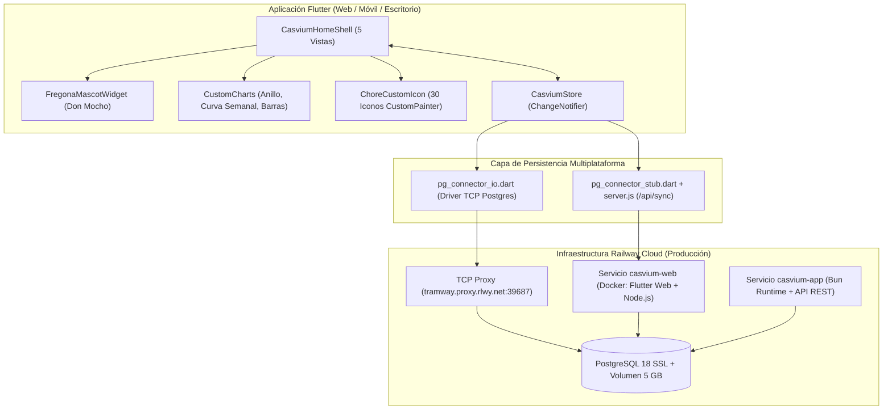
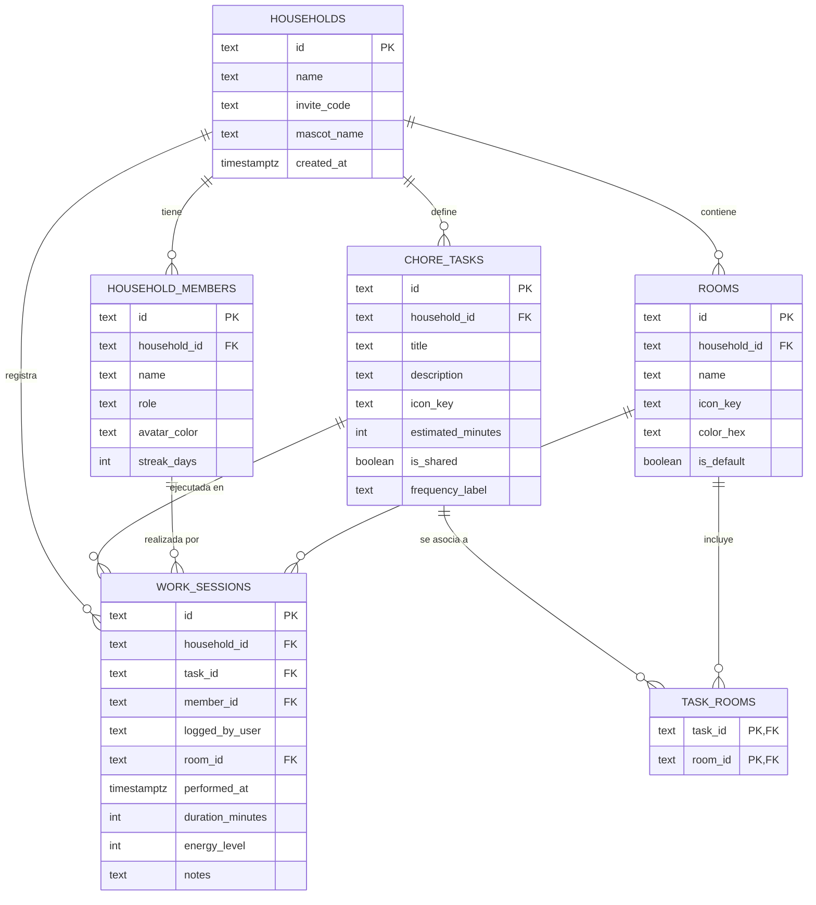

# Documentación Técnica y Funcional de Casvium

**Casvium** es una aplicación multiplataforma desarrollada en **Flutter** para la gestión colaborativa y visual de tareas domésticas, respaldada por una base de datos relacional **PostgreSQL** alojada en **Railway** y con despliegue continuo (CI/CD) desde **GitHub**.

---

## 1. Visión General y Filosofía Visual ("Neo-Bento Artesanal")

El diseño de **Casvium** se aleja deliberadamente de la apariencia estándar de Material Design para ofrecer una experiencia cálida, táctil y editorial inspirada en cuadernos de hogar ilustrados y tableros modulares (*Bento grids*).

### 1.1 Paleta Cromática (`CasviumColors`)
Definida en [`lib/theme/casvium_theme.dart`](../lib/theme/casvium_theme.dart):

| Token | Código Hex | Uso principal |
| :--- | :--- | :--- |
| `canvas` | `#F6F1E7` | Fondo general cálido (papel crema) |
| `surface` | `#FFFCF5` | Superficie principal de tarjetas y modales |
| `surfaceAlt` | `#EDE5D5` | Pistas de gráficos, fondos secundarios y selectores |
| `ink` | `#1E1C1A` | Trazos vectoriales, bordes de 2 px, sombras sólidas y tipografía |
| `inkMuted` | `#655E54` | Subtítulos, etiquetas secundarias y metadatos |
| `terracotta` | `#E06D53` | Acento primario, acciones principales y alertas cálidas |
| `sage` | `#4A7C59` | Tareas compartidas, confirmaciones y naturaleza |
| `mustard` | `#E5A93C` | Insignias de tiempo, resaltados y guantes de Don Mocho |
| `cobalt` | `#3B7097` | Elementos de agua, limpieza e higiene |
| `plum` | `#845EC2` | Configuración de nube Railway y dormitorios |
| `mint` | `#68B0AB` | Indicadores de conexión activa y burbujas de jabón |

### 1.2 Componentes Personalizados (`lib/widgets/custom_components.dart`)
* **`CasviumBentoCard`**: Contenedor táctil con borde sólido de `2.0 px` en color tinta (`#1E1C1A`), esquinas redondeadas (`22 px`) y sombra desplazada sin difuminado (`Offset(4, 4)`). Al pulsarse, ejecuta una animación física de compresión desplazando la tarjeta hacia su sombra.
* **`CasviumActionPill`**: Botón tipo píldora con sombra sólida desplazada y respuesta elástica al toque.
* **`CasviumFloatingDock`**: Barra de navegación inferior flotante sobre fondo tinta (`#1E1C1A`) que sustituye al `BottomNavigationBar` clásico, integrando iconos vectoriales propios y expansión animada (`Curves.easeOutBack`).
* **`DurationCustomSelector`**: Selector interactivo de duración en minutos que combina un control deslizante personalizado (`5` a `120` minutos) con píldoras de selección rápida (`5m`, `10m`, `15m`, `20m`, `30m`, `45m`, `60m`, `90m`).

---

## 2. Arquitectura del Proyecto



### Estructura de Directorios

```text
Casvium/
├── Dockerfile                              # Build multi-etapa (Flutter Web + servidor Node/PG)
├── server.js                               # Servidor estático + pasarela REST hacia PostgreSQL
├── pubspec.yaml                            # Dependencias Flutter (postgres, intl, shared_preferences)
├── sql/
│   └── railway_schema.sql                  # Esquema DDL completo para PostgreSQL
├── doc/
│   └── casvium.md                          # Documentación integral del proyecto
├── lib/
│   ├── main.dart                           # Punto de entrada de la aplicación
│   ├── theme/
│   │   └── casvium_theme.dart              # Paleta cromática y tema tipográfico
│   ├── models/
│   │   └── models.dart                     # Entidades: Household, HouseholdMember, Room, ChoreTask, WorkSession
│   ├── data/
│   │   └── chore_icons.dart                # Catálogo y CustomPainter de los 30 iconos vectoriales
│   ├── services/
│   │   ├── railway_postgres_service.dart   # Estado reactivo, datos semilla y sincronización
│   │   ├── pg_connector_io.dart            # Conexión directa TCP/SSL con PostgreSQL (Nativo)
│   │   └── pg_connector_stub.dart          # Conector para compilación Web
│   ├── widgets/
│   │   ├── fregona_mascot.dart             # Mascota animada "Don Mocho" (CustomPainter)
│   │   ├── custom_charts.dart              # Infografías y gráficas a medida
│   │   └── custom_components.dart          # Tarjetas Bento, Dock flotante, Selector de duración
│   └── screens/
│       └── casvium_home_shell.dart         # Pantalla principal con las 5 secciones y modales
└── test/
    └── widget_test.dart                    # Pruebas de humo e integridad del catálogo
```

---

## 3. Modelo de Datos y Esquema PostgreSQL

El esquema físico se encuentra en [`sql/railway_schema.sql`](../sql/railway_schema.sql) y soporta múltiples hogares, miembros, estancias por defecto y personalizadas, tareas asociadas a **una o varias estancias** (relación N:M mediante `task_rooms`) y sesiones de trabajo históricas.



### Campos registrados en cada Sesión de Trabajo (`WorkSession`)
* **`performedAt`**: Fecha y hora de ejecución de la tarea.
* **`memberId`**: Miembro principal que ejecutó la tarea.
* **`coWorkerIds`**: Lista de miembros adicionales cuando la tarea se realiza en equipo.
* **`loggedByUser`**: Usuario que registra el parte de la sesión en la aplicación.
* **`taskId`**: Tarea doméstica realizada (permite comparar duración real frente a `estimatedMinutes`).
* **`roomId`**: Estancia específica donde se llevó a cabo la sesión.
* **`durationMinutes`**: Duración real invertida en minutos.
* **`energyLevel`** y **`notes`**: Valoración de la sesión (`1..5`) y observaciones.

---

## 4. Catálogo de 30 Iconos Vectoriales (`ChoreIconsCatalog`)

Implementados en [`lib/data/chore_icons.dart`](../lib/data/chore_icons.dart) mediante la clase `_ChoreVectorPainter` (`CustomPainter`). Cada icono se dibuja de forma procedural con trazos de tinta (`StrokeCap.round`) y rellenos cromáticos por categoría:

| # | Clave (`iconKey`) | Etiqueta | Categoría |
| :--- | :--- | :--- | :--- |
| 1 | `mop_bucket` | Cubo y fregona | Suelos |
| 2 | `vacuum` | Aspiradora | Suelos |
| 3 | `broom_dustpan` | Escoba | Suelos |
| 4 | `dust_feather` | Plumero | Superficies |
| 5 | `window_spray` | Pulverizador | Superficies |
| 6 | `rug_beater` | Alfombra | Suelos |
| 7 | `dishes_sponge` | Plato | Cocina |
| 8 | `dishwasher` | Lavavajillas | Cocina |
| 9 | `stove_flame` | Fogón | Cocina |
| 10 | `oven_sparkle` | Horno | Cocina |
| 11 | `fridge_clean` | Nevera | Cocina |
| 12 | `cooking_pot` | Olla | Cocina |
| 13 | `grocery_bag` | Bolsa de compra | Cocina |
| 14 | `pantry_jars` | Tarro | Cocina |
| 15 | `washing_machine` | Lavadora | Colada |
| 16 | `clothesline` | Camiseta tendida | Colada |
| 17 | `steam_iron` | Plancha | Colada |
| 18 | `folded_shirts` | Ropa doblada | Colada |
| 19 | `shoe_rack` | Bota | Colada |
| 20 | `toilet_brush` | Inodoro | Baño |
| 21 | `shower_head` | Ducha | Baño |
| 22 | `sink_faucet` | Lavabo | Baño |
| 23 | `towels_stack` | Toalla | Baño |
| 24 | `bed_pillow` | Cama | Dormitorio |
| 25 | `fresh_sheets` | Sábana | Dormitorio |
| 26 | `wardrobe_hanger` | Percha | Dormitorio |
| 27 | `trash_bin` | Cubo de basura | Hogar |
| 28 | `recycle_loop` | Símbolo de reciclaje | Hogar |
| 29 | `watering_can` | Regadera | Exterior |
| 30 | `pet_care` | Huella | Hogar |

---

## 5. Mascota Animada: "Don Mocho" (`FregonaMascotWidget`)

Ubicada en [`lib/widgets/fregona_mascot.dart`](../lib/widgets/fregona_mascot.dart), **Don Mocho** es una fregona humanizada renderizada en tiempo real con `CustomPainter` y dos controladores de animación (`_idleController` en bucle continuo de `2.8 s` y `_bounceController` para saltos de celebración al tocarla):

1. **Cabellera de flecos de algodón**: 9 hebras independientes con curvas Bézier cuadráticas que oscilan con desfase sinusoidal (`math.sin(phase + i * 0.45)`).
2. **Casquete roscado y rostro expresivo**: Casquete cobalto con banda terracota, ojos con brillo pupilar y parpadeo periódico automático (`math.sin(phase * 1.7) > 0.94`), mejillas sonrojadas y boca que cambia entre sonrisa tranquila y canto de celebración.
3. **Tronco de madera, botas de goma y brazos enguantados**: Palo de madera con inclinación armónica, botas terracota y guantes amarillos que saludan o frotan según el estado (`MascotMood.happy`, `MascotMood.scrubbing`, `MascotMood.celebrating`, `MascotMood.relaxed`).
4. **Burbujas de jabón ascendentes**: 4 burbujas semitransparentes en tono menta que ascienden y oscilan alrededor de la mascota.
5. **Bocadillo de diálogo reactivo**: Cambia automáticamente al iniciar el cronómetro en vivo, al guardar una sesión de trabajo o al pulsar sobre la mascota.

---

## 6. Gráficas e Infografías (`lib/widgets/custom_charts.dart`)

1. **`MemberEquityRingChart` (Anillo de Equidad del Hogar)**:
   * Calcula los minutos aportados por cada miembro (incluyendo el 50 % de bonificación colaborativa para co-ejecutores en tareas compartidas).
   * Dibuja un gráfico de anillo segmentado con bordes de tinta estilo sello editorial y barras horizontales animadas con `TweenAnimationBuilder`.
2. **`WeeklyPulseWaveChart` (Curva Semanal de Pulso Doméstico)**:
   * Agrega los minutos trabajados en cada uno de los últimos 7 días.
   * Traza una curva spline cúbica suave (`cubicTo`) con relleno degradado (`terracotta` a `mustard`) y puntos de control destacados.
3. **`RoomEffortInfographic` (Mapa de Dedicación por Estancia)**:
   * Compara visualmente los minutos invertidos y el número de tareas asociadas en cada estancia del hogar mediante barras proporcionales coloreadas según la identidad de cada habitación.
4. **Indicador de Eficiencia (Estimado vs. Real)**:
   * En cada tarjeta de la bitácora de sesiones se calcula automáticamente la desviación entre la duración real de la sesión (`durationMinutes`) y la duración estimada de la tarea (`estimatedMinutes`).

---

## 7. Estancias por Defecto y Tareas Frecuentes Precargadas

### 7.1 Estancias por Defecto (7 estancias)
1. **Cocina** (`cooking_pot`, `#E06D53`)
2. **Baño Principal** (`shower_head`, `#68B0AB`)
3. **Salón-Comedor** (`vacuum`, `#E5A93C`)
4. **Dormitorio** (`bed_pillow`, `#845EC2`)
5. **Lavadero y Colada** (`washing_machine`, `#3B7097`)
6. **Terraza y Plantas** (`watering_can`, `#4A7C59`)
7. **Recibidor y Pasillo** (`shoe_rack`, `#C85A32`)

### 7.2 Tareas Domésticas de Ejemplo (9 tareas frecuentes)
1. **Fregar suelos con jabón neutro** (`25 min`, compartida, *Cocina, Baño Principal, Salón-Comedor, Recibidor*)
2. **Vaciar y cargar el lavavajillas** (`12 min`, compartida, *Cocina*)
3. **Desinfectar ducha, mampara y lavabo** (`20 min`, compartida, *Baño Principal*)
4. **Pasar aspiradora a alfombras y sofá** (`20 min`, compartida, *Salón-Comedor, Dormitorio, Recibidor*)
5. **Poner lavadora y tender colada al sol** (`18 min`, compartida, *Lavadero y Colada, Terraza y Plantas*)
6. **Cambiar sábanas y ventilar colchón** (`15 min`, individual, *Dormitorio*)
7. **Limpiar vitrocerámica y campana** (`15 min`, compartida, *Cocina*)
8. **Bajar basura orgánica y reciclaje** (`10 min`, compartida, *Cocina, Recibidor y Pasillo*)
9. **Regar macetas y barrer terraza** (`15 min`, individual, *Terraza y Plantas, Salón-Comedor*)

---

## 8. Infraestructura en Railway y Despliegue Continuo (GitHub CI/CD)

### 8.1 Identificadores de Recursos en Railway
* **Proyecto**: `Casvium` (`d3aca41b-4b0d-4cb7-a2d9-41c8ca58e737`)
* **Entorno**: `production` (`44d6481f-78eb-4000-bb03-8dae2d156749`)
* **Repositorio GitHub vinculado**: `https://github.com/undy27/casvium` (rama `main`)

### 8.2 Servicios Activos
1. **Base de Datos `Postgres`** (`ddb8b68f-6ee1-4d54-b01f-4c233cdc6c19`):
   * Imagen: `ghcr.io/railwayapp-templates/postgres-ssl:18`
   * Volumen persistente: `postgres-volume` (`85e99c45-79c4-4aa0-9021-29663f22fa99`, 5000 MB en `europe-west4-drams3a`)
   * Endpoint TCP Público: `tramway.proxy.rlwy.net:39687` (redirige al puerto `5432`)
2. **Aplicación Flutter Web `casvium-web`** (`65d3d267-3af3-422e-8ab1-695bf2645a1b`):
   * Conectada a `undy27/casvium@main` con auto-deploy en cada `git push`.
   * Construida mediante el [`Dockerfile`](../Dockerfile) multi-etapa (compila Flutter Web en modo release y lo sirve con [`server.js`](../server.js) conectado a `${{Postgres.DATABASE_URL}}`).
   * **URL Pública**: `https://casvium-web-production.up.railway.app`
3. **Servicio API/Bun `casvium-app`** (`aab6560c-bb76-4f4b-a176-d48d237b259a`):
   * Función serverless en Bun conectada a `${{Postgres.DATABASE_URL}}` con endpoints REST (`/api/state`, `/api/tasks`, `/api/sessions`, `/api/sync`).
   * **URL Pública**: `https://casvium-app-production.up.railway.app`

---

## 9. Guía de Uso y Comandos

### Ejecución en local (Escritorio / Móvil / Web)
```powershell
# 1. Generar carpetas nativas de plataforma si no existen
flutter create .

# 2. Instalar dependencias
flutter pub get

# 3. Ejecutar la aplicación
flutter run

# 4. (Opcional) Ejecutar inyectando directamente la URL pública de Railway Postgres
flutter run --dart-define=DATABASE_URL=postgresql://postgres:<PASSWORD>@tramway.proxy.rlwy.net:39687/railway
```

### Ejecución de tests
```powershell
flutter test
```

### Flujo de actualización y despliegue automático a Railway
```powershell
git add -A
git commit -m "Descripción del cambio"
git push origin main
```
Cada `git push` a la rama `main` compila y publica automáticamente la nueva versión en `https://casvium-web-production.up.railway.app`.
